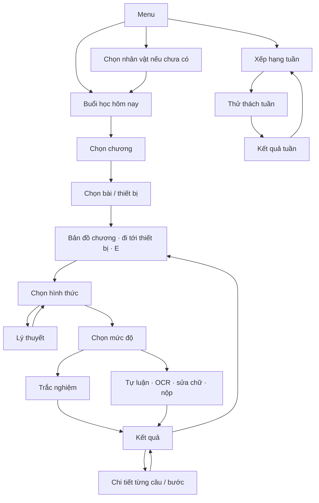

# AURELIA ACADEMY — Đặc tả luồng 34 ảnh để Antigravity triển khai

**Phiên bản 1.0 · 28/10/2026 · GameId: `AURELIA_G2`**

Đây là đặc tả cho game khôi phục học viện trong 34 ảnh đã gửi. Không áp dụng gameplay bắn vịt của game khác. Tài liệu quy định hành vi cần code; không phải báo cáo rằng project Unity đã chạy được. Chưa có mã nguồn Unity trong phiên làm việc này để kiểm thử.

## 1. Cốt truyện và những quyết định dùng để code

Học viện Aurelia mất nguồn năng lượng tri thức. Người chơi chọn một học viên, đi tới các thiết bị ở năm khu vực, học và giải câu hỏi để khôi phục từng thiết bị. Đạt ít nhất 80/100 trong một lượt hợp lệ sẽ khôi phục thiết bị gắn với bài đó. Khi tất cả thiết bị của một chương được khôi phục, khu vực sáng hoàn toàn. Đủ 21 thiết bị thì mở thành tích Người hồi sinh Aurelia.

- Cả năm chương mở ngay từ đầu. Không khóa chương sau, bài sau hay bài kiểm tra chương bằng việc hoàn thành trước đó.
- Chương I có 4 thiết bị; II có 7; III có 4; IV có 3; V có 3. Thiết bị cuối mỗi chương là bài kiểm tra chương.
- Một lượt trắc nghiệm **hoặc** tự luận đạt ngưỡng có thể khôi phục một thiết bị bài học; không bắt buộc hoàn thành cả hai chế độ. Thiết bị kiểm tra chương dùng trắc nghiệm tổng hợp 10 câu.
- Đọc lý thuyết không tự khôi phục thiết bị. Điểm thấp ở lần làm lại không làm thiết bị tối trở lại.
- 34 ảnh không đồng nghĩa 34 màn nghiệp vụ độc lập. Hai ảnh Cài đặt là hai trạng thái; bốn ảnh Thành tích là hai trang với các trạng thái khóa; bản đồ sáng là trạng thái hoàn thành.
- Chưa code các màn chưa gửi: chọn giáo viên, kho đồ, quản lý, hướng dẫn riêng, đối kháng, tổng ôn toàn quyển. Không tạo đường dẫn tới các scene đó.
- Không thêm màn Tổng kết buổi học. Hết buổi dùng popup và dữ liệu buổi gần nhất ở màn 22.
- Không có nút tiếp tục bài làm dở sau khi tắt game. Kết quả đã nộp vẫn được lưu và tra cứu; điều này khác với tiếp tục một lượt chưa nộp.

**Các lựa chọn thiết kế do bản đặc tả này chốt:** dùng màn 05 để chọn thiết bị muốn đi tới trước khi vào bản đồ; dùng scene 32 làm kết quả thử thách tuần; nút Thành tích bị lặp ở menu đổi thành Chọn nhân vật; thời gian thử thách tuần mặc định 15 phút. Các lựa chọn này không được suy ra là đã có code trong ảnh.

## 2. Luồng tổng quan



Bài kiểm tra chương đi từ Chọn hình thức thẳng vào trắc nghiệm với đề hỗn hợp; không qua chọn mức độ. Thử thách tuần là luồng riêng, không cộng khôi phục thiết bị.

## 3. Đối chiếu đủ 34 ảnh với scene và route

Số thứ tự dưới đây là thứ tự ảnh đã nhận, không phải Build Index. Anti phải lấy đường dẫn/GUID thực tế trong project, tạo `SceneCatalog`, rồi ánh xạ route. **Không dùng số đứng đầu tên scene làm chỉ số LoadScene.** Không đổi tên hoặc xóa scene hàng loạt khi chưa kiểm tra tham chiếu.

|Ảnh|Tên scene nhìn thấy / nội dung|Route hoặc trạng thái sẽ dùng|Cần xử lý|
|---|---|---|---|
|01|01_MainMenu|MainMenu|Hai nút Thành tích trùng nhau; sửa một nút thành Chọn nhân vật|
|02|02_CharacterSelection|CharacterSelection|Chọn 1 trong 4, có trạng thái đang chọn|
|03|04_ChapterSelection|ChapterSelection|Năm chương mở; hiển thị tiến độ thật|
|04|05_LessonSelection|LessonSelection|Danh sách đổi theo chương, gồm bài kiểm tra cuối|
|05|06_Chuong I|ChapterMap(chuong1)|4 thiết bị|
|06|07_Chuong II|ChapterMap(chuong2)|7 thiết bị; thống nhất tên Thư viện Ánh sáng|
|07|08_Chuong III|ChapterMap(chuong3)|4 thiết bị|
|08|09_Chuong IV 1|ChapterMap(chuong4)|Tháp Cảm ứng, 3 thiết bị|
|09|10_Chuong V 2|ChapterMap(chuong5)|Vườn Năng lượng, 3 thiết bị|
|10|11.1_Quiz 1 — Thử thách tuần|WeeklyQuiz|Thêm đồng hồ 15 phút và trạng thái đã trả lời|
|11|11_Quiz — Trắc nghiệm|PracticeQuiz|Không hiển thị đồng thời thông báo đúng và sai|
|12|12_WrittenAnswer|EssayAnswer|Câu 1/50 phải thay bằng i/N; bổ sung OCR và xác nhận bản chữ|
|13|14.2_Settings 1 — OFF|Settings, toggle=false|Trạng thái của cùng màn, không chuyển scene khi bật/tắt|
|14|14_Settings — ON|Settings, toggle=true|Dùng một controller/một màn runtime|
|15|15.1_Achievements (màn 2) — trang 1 mở|Achievements(page=1)|Ảnh tham chiếu trạng thái mở|
|16|15.3_Achievements 1 — trang 1 khóa|Achievements(page=1)|Khóa/mở từng dòng theo dữ liệu|
|17|15.4_Achievements — trang 2 khóa|Achievements(page=2)|Cùng controller và dữ liệu|
|18|15_Achievements 1 — trang 2 mở|Achievements(page=2)|Cho phép trạng thái mở/khóa lẫn nhau|
|19|17_Type|ModeSelection|Đối kháng chưa triển khai; phản hồi rõ khi bấm|
|20|18_Theory|Theory|Nội dung thật, không giữ “Lý thuyết nè”|
|21|19_Result_TN nhưng tiêu đề TỰ LUẬN|EssayResult|Ánh xạ theo nội dung, tên file đang đảo|
|22|19.1_Result_TL nhưng tiêu đề TRẮC NGHIỆM|QuizResult|Ánh xạ theo nội dung, tên file đang đảo|
|23|20_Detail Result TN|QuizReview|Hiển thị từ snapshot lượt đã nộp|
|24|20.1_Detail Result TL|EssayReview|Bổ sung bài người học và nhận xét từng bước|
|25|22_Buoi hoc hom nay|StudySessionSetup|15/30/45 phút; không giữ số buổi mẫu|
|26|23_Bảng xếp hạng|WeeklyLeaderboard|Dữ liệu server, 1 lượt tính hạng/tuần|
|27|24_Tiến bộ học tập|LearningProgress|Phân biệt hình thức, mức độ, bài và phiên bản chấm|
|28|27_Chuong I after|ChapterMap(chuong1), complete|Giữ nhân vật, vị trí và tương tác|
|29|28_Chuong II after 1|ChapterMap(chuong2), complete|Ảnh dùng 7 hình thiết bị giống nhau; không đổi DeviceId/đảo bài theo hình|
|30|29_Chuong III after|ChapterMap(chuong3), complete|4/4 chỉ khi dữ liệu thật đủ|
|31|30_Chuong IV after 1 nhưng VƯỜN NĂNG LƯỢNG|ChapterMap(chuong5), complete|**Tên chương bị đảo**|
|32|31_Chuong V after 2 nhưng THÁP CẢM ỨNG|ChapterMap(chuong4), complete|**Tên chương bị đảo**|
|33|32_Result_Tự luận nhưng tiêu đề TRẮC NGHIỆM|WeeklyResult, dùng lại bố cục|Đổi tiêu đề Kết quả thử thách tuần, nút về bảng xếp hạng|
|34|33_Chọn độ khó|DifficultySelection|NB/TH/VD/VDC, đếm số câu thực trước Bắt đầu|

Các số 80, 8, 2, 30 phút, tên người chơi và điểm trong ảnh là mẫu giao diện. Không giữ dưới dạng ảnh/text cố định để giả làm dữ liệu thật. Xóa số “8” rời ở màn kết quả. Nếu chữ đã dính vào ảnh nền, dùng asset rời hoặc che đúng vùng rồi đặt TMP text; không chồng số mới lên số cũ.

## 4. Bảng bài và thiết bị — nguồn chuẩn để nối dữ liệu

|Chương / map|Thiết bị → BaiID theo thứ tự số trong map|Mục tiêu cốt truyện|
|---|---|---|
|I · Sân Cơ học|1→bai2; 2→bai3; 3→bai4; 4→test_chuong1|Khôi phục nguồn cơ năng|
|II · Thư viện Ánh sáng|1→bai5; 2→bai6; 3→bai7; 4→bai8; 5→bai9; 6→bai10; 7→test_chuong2|Đánh thức nguồn sáng|
|III · Xưởng Điện|1→bai11; 2→bai12; 3→bai13; 4→test_chuong3|Đưa dòng điện trở lại học viện|
|IV · Tháp Cảm ứng|1→bai14; 2→bai15; 3→test_chuong4|Đánh thức nhịp đập của tháp|
|V · Vườn Năng lượng|1→bai16; 2→bai17; 3→test_chuong5|Gieo nguồn sáng cho ngày mai|

Mã thiết bị chuẩn là `G2_C1_D01`… theo tab `G2_ThietBi`. Không dùng tên GameObject hoặc vị trí phần tử trong Hierarchy làm khóa dữ liệu. `test_tonghop` giữ trong ngân hàng nhưng chưa đưa vào luồng 34 ảnh này.

## 5. Hợp đồng điều hướng và trạng thái chung

Một `NavigationService` quản lý chuyển màn. Trạng thái truyền bằng đối tượng, không đọc lại từ tiêu đề giao diện:

```
GameContext: GameId, UserId, CharacterId, SessionId
Selection: ChapterId, LessonId, DeviceId, Mode, Difficulty
AttemptContext: AttemptId, Source, BankVersion, QuestionOrder
ReturnContext: OriginRoute, ChapterId, DeviceId, PlayerPosition, SelectedLessonId
```

`Source` là `RESTORATION`, `PROGRESS_PRACTICE`, `WEEKLY_RANKED` hoặc `WEEKLY_PRACTICE`. Không suy ra nguồn từ scene kết quả.

- Sau click chuyển màn: khóa riêng nút trong lúc chuyển, hiện trạng thái đang tải, chỉ một lần chuyển. Lỗi tải thì gỡ khóa và cho Thử lại/Quay lại, giữ dữ liệu hiện có.
- Nếu thiếu dữ liệu bắt buộc: không load scene nửa chừng. Hiện lỗi cụ thể và quay về nơi chọn dữ liệu gần nhất. Ví dụ thiếu LessonId → Chọn bài; thiếu AttemptId ở review → Tiến bộ/Menu.
- Trong Editor mở riêng một scene vẫn phải chạy: dùng DevContext được ghi rõ “Dữ liệu thử”, hoặc hiển thị nút về Menu. Không âm thầm tạo điểm thật cho tài khoản.
- Nút Back/Esc đóng modal trên cùng trước; nếu không có modal mới thực hiện Back của màn. Không pop một stack cũ để trở về bài đã nộp trong trạng thái có thể sửa.
- Trạng thái modal/loading/error là panel trên màn hiện tại; không cần thiết kế thêm scene chưa gửi.
- Mọi nút không khả dụng phải có lý do cạnh nút hoặc thông báo khi chạm vùng trợ giúp; tuyệt đối không chỉ bỏ listener rồi để nút trông như hoạt động.

## 6. Từng click ở các màn chọn và menu

### 6.1 MainMenu — ảnh 01

|Thao tác|Xử lý|Đích|
|---|---|---|
|Bắt đầu, chưa có nhân vật|Tạo luồng chọn nhân vật với returnAction=StartStudy|CharacterSelection|
|Bắt đầu, đã có nhân vật|Nạp hồ sơ và buổi gần nhất|StudySessionSetup|
|Chọn nhân vật, thay nút Thành tích bị lặp|Nạp lựa chọn hiện tại, returnAction=ReturnMenu|CharacterSelection|
|Thành tích|Tải 12 trạng thái của đúng UserId|Achievements trang 1|
|Cài đặt|Lấy giá trị đã lưu|Settings|
|Xếp hạng|Nạp tuần hiện tại từ server|WeeklyLeaderboard|
|Tiến độ|Nạp lịch sử đã hoàn tất|LearningProgress|
|Quay lại|Gọi HostNavigation về màn chọn Game 1/Game 2 nếu project đã có|Menu cha của nhóm|

Nếu chưa có host menu để nối, Quay lại hiện popup “Bạn đang ở menu chính” với Đóng game/Hủy. Build desktop có thể thoát; Editor dừng Play qua mã chỉ trong Editor; WebGL chỉ đóng popup hoặc điều hướng host được cấu hình. Không hardcode một scene chưa gửi hoặc gọi `Application.Quit` rồi để nút trông không phản hồi trên WebGL.

### 6.2 CharacterSelection — ảnh 02

Click nhân vật → `selectedCharacterId` đổi, hiện viền/sáng và dấu chọn; chỉ một lựa chọn. Không tự chuyển màn. Lần đầu có thể chọn sẵn nhân vật thứ nhất để tránh nút xác nhận vô nghĩa. Xác nhận → lưu hồ sơ → đi StudySessionSetup nếu đang bắt đầu học, ngược lại về Menu. Back → hủy thay đổi chưa xác nhận, về Menu. Nhân vật đã chọn phải xuất hiện đúng cả bản đồ tối và sáng.

### 6.3 StudySessionSetup — ảnh 25

Mặc định 30 phút. Click 15/30/45 chỉ đổi lựa chọn, không bắt đầu đồng hồ. Bên phải là **buổi đã kết thúc gần nhất của tài khoản**, chưa có thì “Chưa có buổi học trước”. Câu đúng chỉ tổng hợp trắc nghiệm, không coi một câu tự luận đạt là một câu trắc nghiệm đúng; tự luận có dòng riêng khi có dữ liệu.

Bắt đầu học → tạo `SessionId`, ghi plannedSeconds, status=Active → ChapterSelection. Click kép chỉ tạo một session. Đồng hồ chỉ bắt đầu tiêu thụ thời gian khi vào hoạt động học/bản đồ. Back → MainMenu, không tạo session. Không có nút tiếp tục bài cũ.

### 6.4 ChapterSelection — ảnh 03

Click đảo chương → đổi selectedChapterId và viền chọn. Xác nhận → kiểm tra chương tồn tại → LessonSelection của chương đó. Cả năm đảo bấm được; hiển thị `đã khôi phục/tổng` theo dữ liệu.

Back → nếu đang có buổi học, hỏi “Kết thúc buổi học và về menu?”; Đồng ý lưu thời gian, kết thúc session, về Menu; Hủy ở lại. Không quay về tạo thêm một session và đặt lại đồng hồ. Vào chương khác trong cùng buổi không reset tiến độ hay thời gian.

### 6.5 LessonSelection — ảnh 04

Danh sách theo bảng ở mục 4, có ScrollRect dùng chuột và thanh kéo. Mỗi dòng là một nút chứa tên bài, icon, trạng thái thiết bị và điểm tốt nhất. Click dòng → chọn bài; Xác nhận → lưu LessonId/DeviceId → ChapterMap tương ứng. Bài đã chọn được đánh dấu chỉ đường/viền trên map; nhân vật vẫn bắt đầu ở lối vào hoặc vị trí đã lưu trong buổi, **không tự mở bài ngay**. Có thể đi sang thiết bị khác để học bài khác.

Back → ChapterSelection, giữ chương đang chọn. Khi mở lần đầu chọn bài đầu tiên hoặc lựa chọn cũ còn hợp lệ. Không hardcode ba dòng bài 5–7 như ảnh: chương II đủ bảy mục. Không tải thiếu bài kiểm tra cuối.

## 7. Bản đồ năm chương và trạng thái khôi phục

Áp dụng ảnh 05–09 và 28–32. Mỗi map có sàn đi được, vùng chặn, vị trí xuất hiện và 3–7 trạm tương tác. Có thể làm bằng SpriteRenderer/Collider2D trong world hoặc tọa độ UI quy đổi chuẩn; Anti phải chọn một cách nhất quán, không trộn tọa độ màn hình với world một cách ngẫu nhiên.

|Thao tác|Hành vi bắt buộc|
|---|---|
|W/A/S/D|Di chuyển theo deltaTime, chuẩn hóa vector chéo, không vượt biên hay xuyên thiết bị; chỉ khi không có modal/input focus|
|Đến gần thiết bị|Hiện tên bài và “Nhấn E để học”; viền trạm gần nhất sáng|
|Nhấn E|Chọn trạm hợp lệ gần nhất trong bán kính; lưu vị trí nhân vật/DeviceId; mở ModeSelection|
|E ngoài phạm vi|Hiện gợi ý ngắn “Đến gần một thiết bị để học”; không mở bài ngẫu nhiên|
|Click thiết bị/nhãn số|Nếu trong phạm vi mở như E; ngoài phạm vi đánh dấu đích và nhắc đi tới; không để nhãn số trông bấm được mà im lặng|
|Pause hoặc Esc|Mở popup Tiếp tục, Cài đặt, Kết thúc buổi; ngừng di chuyển và timer học|
|Tiếp tục trong popup pause|Đóng popup, trở lại đúng map và thời gian còn lại; đây không phải tính năng tải lại bài dở sau mở game|
|Cài đặt từ pause|Mở Settings với returnRoute=Pause; Back trở lại pause của map|
|Chọn chương|Lưu vị trí trong buổi; mở ChapterSelection, giữ session và timer|
|Click thiết bị đã sáng|Vẫn học/luyện lại được, không cộng thêm một thiết bị|

Khi quay từ kết quả: tải trạng thái tiến độ trước, dựng nhân vật tại điểm đứng cạnh trạm (không trong collider), rồi phát animation khôi phục nếu đây là lần đầu trạm vừa đạt. Tăng đếm duy nhất một lần. Khôi phục thiết bị thứ 7 chương II → từ 6/7 sang 7/7, hiện thông báo hoàn tất rồi vẫn ở map.

**Trạng thái một phần là bắt buộc:** 1/7 hoặc 5/7 phải sáng đúng các trạm đã đạt. Không chỉ có hai ảnh 0/7 và 7/7 rồi bật sáng toàn map khi đạt một bài. Nền/thiết bị nếu đang gộp trong một RawImage phải được tách hoặc phủ sprite đúng vùng; collider và DeviceId không đổi theo art. Với ảnh chương II sau khôi phục dùng hình bình nước lặp lại, ưu tiên giữ hình dạng bảy thiết bị gốc và thêm hiệu ứng sáng riêng, tránh làm người chơi mất nhận diện bài.

## 8. Chọn hình thức, mức độ và lý thuyết

### 8.1 ModeSelection — ảnh 19

Tiêu đề bài lấy từ LessonId. Click lựa chọn chỉ đổi selection; Xác nhận mới thực hiện.

|Lựa chọn|Xác nhận đi đâu|Điều kiện|
|---|---|---|
|Học lý thuyết|Theory|Có nội dung hợp lệ; bài kiểm tra chương dùng phần tổng hợp của chương|
|Trắc nghiệm — bài học|DifficultySelection, mode=MCQ|Có ngân hàng đúng bài|
|Trắc nghiệm — kiểm tra chương|Tạo lượt 10 câu hỗn hợp → PracticeQuiz|Blueprint 3 NB + 3 TH + 3 VD + 1 VDC|
|Tự luận — bài học|DifficultySelection, mode=ESSAY|Có câu và rubric đã duyệt cho chế độ chính thức|
|Tự luận — kiểm tra chương|Ở lại, thông báo “Bài kiểm tra chương hiện có trắc nghiệm”|Không lấy câu tự luận của bài khác để lấp chỗ trống|
|Đối kháng|Ở lại, popup “Chế độ đối kháng sẽ bổ sung ở đợt sau”|Không load scene 34 chưa nằm trong phạm vi|

Back → map gốc, đúng vị trí. Người đến từ Tiến bộ sẽ Back về Tiến bộ theo returnContext. Có thể chọn sẵn Trắc nghiệm, nhưng vẫn hiện rõ trạng thái đang chọn.

### 8.2 DifficultySelection — ảnh 34

Click Nhận biết/Thông hiểu/Vận dụng/Vận dụng cao → chọn mã `NB/TH/VD/VDC`. Dưới lựa chọn hiển thị số câu thực, ví dụ “Vận dụng cao · 3 câu · đạt từ 80%”.

Bắt đầu → backend chọn bộ câu đủ điều kiện, tạo AttemptId và snapshot → vào PracticeQuiz hoặc EssayAnswer. Không tạo lượt ở mỗi lần đổi thẻ. Back → ModeSelection, giữ hình thức.

Với số câu bằng 0: hiện “Chưa có câu hỏi ở mức này”, nút Bắt đầu không khả dụng và giải thích rõ; người chơi chọn mức khác. Nếu ngân hàng tải lỗi: Thử lại / Quay lại, không coi lỗi là không có câu.

**Chính sách số câu:** MCQ `N=min(10, eligibleCount)`; tự luận `N=min(5, eligibleCount)`. Không lặp cùng câu trong một lượt, không âm thầm trộn mức hoặc bài. Hiện dữ liệu tự luận chỉ có 1 câu/bài/mức. Nếu muốn cố định 5 câu tự luận thì cần biên soạn thêm; đây là thiếu nội dung, không phải lỗi điều hướng.

### 8.3 Theory — ảnh 20

Nạp `LyThuyetBaiHoc` bằng BaiID. Khung trái hiển thị nội dung; phải có scroll nếu dài. Khung phải ghi nhớ từ khái niệm/công thức/ứng dụng, không bịa thêm từ placeholder.

- Nếu chia trang: Tiếp theo → trang kế, thêm Trang trước khi page>1; trang cuối đổi Tiếp theo thành “Luyện tập”. Nếu một trang cuộn: nút luôn là Luyện tập.
- Luyện tập → ModeSelection, chọn sẵn Trắc nghiệm. Chưa tự tạo attempt/chưa cộng điểm.
- Quay lại → ModeSelection; giữ bài và vị trí map.
- Video chỉ hiện khi có URL video cụ thể hợp lệ. URL trang chủ YouTube trong Excel không được coi là video bài học. Mở video ngoài ứng dụng theo popup thông báo; đóng popup vẫn ở lý thuyết.

## 9. Trắc nghiệm luyện tập — ảnh 11

Mỗi câu có trạng thái `Unanswered → AnsweredLocked`. Khi chọn A/B/C/D: lưu optionId ổn định, gửi chấm câu, khóa bốn đáp án của câu đó; nhận phản hồi thì chỉ hiện **một** thanh đúng hoặc sai. Không cho đổi đáp án sau khi đã thấy đáp án đúng để tăng điểm. Nếu request lỗi, cho retry cùng requestId, không mất lựa chọn.

- “Câu i/N” lấy N của attempt. Đề, hình và đáp án từ snapshot, không lấy một câu mới khi nhấn Next.
- Tiếp theo: câu chưa trả lời thì chưa cho qua, ghi “Chọn đáp án để tiếp tục”; câu đã trả lời → câu kế. Câu cuối đổi thành Nộp bài.
- Quay lại: ở câu i>1 → câu trước, chỉ đọc lựa chọn đã khóa; ở câu đầu → popup Rời lượt học? Xác nhận bỏ lượt → ModeSelection; Hủy ở lại.
- Nộp bài: mọi câu đã trả lời → xác nhận → backend tổng hợp/lưu kết quả đúng một lần → QuizResult. Chưa đủ thì chỉ rõ câu thiếu và đưa tới câu đầu thiếu.
- Sau nộp không thể Back vào lượt cũ để sửa. Làm lại tạo AttemptId mới.
- Ngân hàng có thể xáo câu giữa các lượt; thứ tự đáp án nếu xáo phải lưu optionId, không chấm theo chữ A/B hiển thị sau xáo mà quên mapping.

Điểm `100 × số đúng / N`. Một bài có 3 câu thì phải đúng cả 3 để đạt ít nhất 80%; 2/3 là 66,67. Một bài có 7 câu cần ít nhất 6 đúng. Không làm tròn 79,96 lên 80 để cấp khôi phục.

## 10. Tự luận: nhập, tải ảnh, sửa chữ và nộp — ảnh 12

### 10.1 Những phần phải bổ sung ngay trong bố cục hiện có

Giữ nền và khung, nhưng thêm nút **Đọc chữ từ ảnh**, trạng thái OCR, panel **Kiểm tra và sửa nội dung nhận dạng**, nút **Dùng bản chữ này** và nút **Đọc lại**. Có thể dùng modal phủ khung hiện tại. Không cần một scene mới.

### 10.2 Từng thao tác

|Thao tác|Hành vi|
|---|---|
|Click Câu 1…N bên trái|Lưu nháp trong bộ nhớ phiên rồi mở đúng câu; không mất text/ảnh câu trước|
|Gõ câu trả lời|Lưu draft theo AttemptId+CauHoiID; tăng inputRevision; có thể xuống dòng, gõ tiếng Việt|
|Tải ảnh|Mở trình chọn tệp; Hủy không thay dữ liệu; nhận JPEG/PNG/WebP theo giới hạn cấu hình|
|Ảnh hợp lệ|Hiện thumbnail, tên/kích thước; chưa tự nộp/chưa chấm|
|Xóa ảnh|Chọn ảnh cần xóa; nếu đã có OCR được đưa vào bài, hỏi giữ hay xóa phần chữ đó; không xóa text gõ tay ngầm|
|Đọc chữ từ ảnh|Gửi ảnh qua OCR service, hiện tiến trình; có Hủy/Thử lại; không gọi hàm chấm ở bước này|
|OCR xong|Mở bản chữ có thể sửa; đánh dấu đoạn không đọc rõ; giữ nguyên lỗi vật lý của học sinh|
|Dùng bản chữ này|Nếu đã gõ tay, cho chọn Ghép vào cuối / Thay toàn bộ / Hủy; ghi bản chữ đã xác nhận vào draft|
|Đọc lại|Tạo OCR revision mới; không ghi đè bản đang sửa nếu câu/ảnh/inputRevision đã đổi|
|Câu trước / Câu tiếp|Di chuyển trong 1…N; ở biên vô hiệu kèm nhãn, không wrap ngẫu nhiên|
|Nộp bài|Kiểm tra từng câu có text cuối cùng, không còn OCR chưa xác nhận; mở xác nhận nộp|
|Xác nhận nộp|Khóa snapshot text/stepIds/imageRefs/rubricVersion; tạo grading jobs; mở EssayResult trạng thái Đang chấm|
|Quay lại khi chưa nộp|Popup cảnh báo bỏ lượt; Hủy giữ bài, Đồng ý bỏ lượt → ModeSelection|

Giới hạn đề xuất: 3 ảnh/câu, 5 MB/ảnh, 10.000 ký tự/câu; cấu hình được. Nếu vượt giới hạn, giải thích và giữ nội dung hiện có; không cắt ngầm. Server xác thực MIME, dung lượng, số pixel và quyền sở hữu; ảnh lỗi không được gửi tiếp như ảnh thành công.

Nếu người học chỉ tải ảnh thì **phải xem/xác nhận bản chữ trước khi nộp**. Ảnh gốc có thể giữ làm minh chứng. Các hình vẽ/sơ đồ không thể diễn đạt đủ bằng OCR phải được đánh dấu cần xem ảnh/duyệt, không chấm 0 chỉ vì thiếu văn bản.

### 10.3 Chấm và trạng thái bất đồng bộ

`Draft → OCRPending → OCRReady → TextConfirmed → Submitted → Grading → Graded`.
Người chỉ gõ chữ đi từ Draft thẳng đến Submitted. Lỗi OCR quay về draft có thể sửa; lỗi chấm có `RetryableError` hoặc `NeedsReview`, không biến thành điểm 0.

Nộp xong text là chỉ đọc. Kết quả về muộn phải gắn đúng AttemptId/CauHoiID/inputHash. Người rời màn trong lúc chấm vẫn giữ bản đã nộp; sau đó vào Tiến bộ → Lịch sử lượt đã nộp để mở trạng thái/kết quả. Đây không phải tiếp tục sửa bài cũ.

Nếu dùng rubric DRAFT để thử nội bộ, hiển thị “Chấm thử — rubric chưa duyệt” và không cộng khôi phục/thành tích. Chế độ học chính thức yêu cầu APPROVED. Thiếu rubric được báo trước khi tạo lượt, tránh học xong mới biết không chấm được.

## 11. Các màn kết quả và chi tiết

### 11.1 QuizResult — ảnh 22

Điểm, số đúng, số sai (=N−đúng), thời gian từ attempt. Nếu timeout/bỏ trống, hiển thị riêng số chưa trả lời trong chú thích, không gọi đó là lỗi AI. Điểm≥80: “Đủ năng lượng khôi phục”; dưới80: “Chưa đủ năng lượng — hãy luyện thêm”. Nếu trạm đã sáng: “Đã hoàn thành — lượt luyện tập mới đã lưu”.

### 11.2 EssayResult — ảnh 21

- Đang chấm: thay số điểm bằng “Đang chấm x/N”; không hiển thị 0/100 hay 80 mẫu.
- Hoàn tất: điểm toàn lượt = trung bình điểm 0–100 của N câu (trọng số bằng nhau ở phiên bản1). Câu đạt = số câu có điểm≥80; Cần cải thiện = N−câu đạt. Không quy mỗi câu tự luận thành đúng/sai tuyệt đối.
- Chấm lỗi/cần duyệt: “Chưa có điểm cuối cùng”, nêu câu cần xử lý, có Thử chấm lại khi retryable. Chưa khôi phục thiết bị, chưa cập nhật best score.
- Điểm toàn lượt≥80 và tất cả câu có kết quả hợp lệ/rubric duyệt → cấp khôi phục duy nhất một lần.

### 11.3 Nút dùng chung ở kết quả

|Nút|RESTORATION|PROGRESS_PRACTICE|
|---|---|---|
|Về khu vực|Map chương từ ReturnContext, cạnh đúng trạm|Đổi nhãn “Về tiến bộ”, về LearningProgress|
|Xem lời giải chi tiết|QuizReview hoặc EssayReview cùng AttemptId|Tương tự|
|Làm lại|Giữ bài/mode/difficulty, tạo lượt mới sau xác nhận; không ghi đè lượt cũ|Tương tự; nếu chưa có buổi học thì qua màn22 với pendingPractice|

Khi session hết giờ, Làm lại đổi thành “Bắt đầu buổi mới” → màn22. Không tạo attempt mới trong session đã hết. Các nút trong lúc chấm: cho rời màn; chi tiết chỉ mở các câu có phản hồi và ghi rõ trạng thái các câu còn lại; Làm lại chỉ sau khi hoàn tất hoặc chủ động tạo lượt khác có cảnh báo không hủy bài đã nộp.

### 11.4 QuizReview — ảnh 23

Danh sách tạo N dòng từ snapshot. Click dòng → câu tương ứng; đáp án đã chọn sai màu đỏ, đáp án đúng xanh; nếu chọn đúng chỉ xanh một đáp án. Dòng “Bạn chọn … / Đáp án đúng …” khớp dữ liệu. Chưa trả lời ghi “Chưa trả lời”, không tự chọn A.

Câu trước/Câu tiếp ở biên hiển thị disabled có lý do; Về kết quả → đúng loại kết quả và AttemptId. Bấm đáp án trong review không thay đổi điểm. Giải thích và mẹo ghi nhớ từ phiên bản nội dung lúc nộp, không dùng dữ liệu vừa bị sửa giữa chừng.

### 11.5 EssayReview — ảnh 24: tô đỏ đúng bước sai

Giữ danh sách câu, điểm, nhận xét, gợi ý. Bổ sung hai tab trong khung phải: **Bài của bạn** và **Lời giải tham khảo**. Tab Bài của bạn hiển thị từng đoạn/bước của bản chữ cuối cùng đã nộp.

|Trạng thái bước|Hiển thị|Nội dung phản hồi|
|---|---|---|
|correct|Xanh + ✓ Đúng|Nêu ý đúng ngắn gọn|
|partial|Vàng + ! Chưa đủ|Thiếu điều kiện/đơn vị/lập luận nào|
|incorrect|Đỏ + ✕ Cần sửa|Trích đúng bước của học sinh; giải thích tại sao sai và đề xuất sửa|
|unassessable|Xám + ? Cần kiểm tra|OCR mờ/hình vẽ thiếu/thông tin chưa đủ; không giả vờ chắc chắn|

Click bước → bung nhận xét ngay dưới bước; không chỉ tô đỏ toàn bài. Tiêu chí bị thiếu nhưng không có đoạn tương ứng xuất hiện dưới “Ý còn thiếu”, không gắn vào một bước do AI bịa. AI không được gửi HTML/TMP markup; client tự tô màu theo enum, escape ký tự của text học sinh.

Ví dụ: học sinh viết “Ánh sáng đi từ môi trường chiết suất nhỏ sang lớn” → bước đỏ, phản hồi “Chiều truyền này chưa thỏa điều kiện phản xạ toàn phần; cần từ chiết suất lớn sang nhỏ”. Nếu bước tiếp theo viết `i > i_gh` đúng thì chỉ bước đó xanh. Điểm từng tiêu chí nằm trong bảng mở rộng, tổng do backend tính.

Về kết quả/Câu trước/Câu tiếp như review trắc nghiệm. Chỉ đọc; muốn sửa phải Làm lại ở kết quả, tạo lượt mới.

## 12. Thử thách tuần và bảng xếp hạng

### 12.1 WeeklyLeaderboard — ảnh 26

Tuần tính theo `Asia/Ho_Chi_Minh`, từ thứ Hai00:00 đến trước thứ Hai kế tiếp. WeekId do server cấp; client không tự đổi đồng hồ để đổi tuần. Mũi tên trái xem tuần trước đã có; phải xem tuần kế tới tối đa tuần hiện tại. Ở biên vô hiệu có giải thích. Scroll hiển thị người chơi thật. Chưa có dữ liệu: “Chưa có người hoàn thành”, không dựng tên/điểm mẫu.

Xếp hạng dùng **dense rank theo điểm** như thiết kế1,2,2,3. Cùng điểm cùng hạng; thứ tự trong nhóm theo thời gian nộp rồi UserId chỉ để ổn định, không đổi hạng. Dòng của tôi ghi chưa tham gia/đang làm/đã nộp/hết giờ. Tuần trước chỉ xem.

Click Tham gia thử thách → popup thể lệ: 10 câu, 15 phút, một lượt tính hạng/tài khoản/tuần; sau bắt đầu không có lượt tính hạng thứ hai, không tiếp tục bài dở sau thoát game. Xác nhận → server kiểm tra và tạo lượt nguyên tử → WeeklyQuiz. Hủy không tiêu lượt.

Nếu đã có lượt: nút đổi Xem kết quả nếu final; nếu đã bỏ/hết giờ cho Xem trạng thái và Luyện tập không tính hạng. Nếu đang có lượt cùng phiên ứng dụng, chỉ quay lại lượt đang mở trong bộ nhớ; không tạo lượt thứ hai. Chưa xác thực/mất mạng: không bắt đầu lượt tính hạng; giải thích và cho xem dữ liệu cache có nhãn thời điểm.

`G2_Tuan` lưu 10 QuestionIds và snapshot cố định cho mọi người trong tuần, chủ đề/chương do cấu hình. Có thể lấy 3NB+3TH+3VD+1VDC từ các bài của chương và test_chuong đó, không dùng test_tonghop lẫn chương khi không được cấu hình. Nếu thiếu câu, tuần không được publish. Đáp án không gửi tới client trước khi chốt lượt.

### 12.2 WeeklyQuiz — ảnh 10

Click đáp án → lưu lựa chọn, cho đổi trước khi nộp; **không hiện đúng/sai**. Câu trước/Câu tiếp cho đi lại tự do; hiển thị tiến độ đã trả lời x/10. Nộp bài thủ công chỉ khi đủ10; thiếu thì báo số câu còn thiếu và nhảy tới câu đầu thiếu. Xác nhận nộp → server khóa đáp án, chấm, cập nhật hạng → WeeklyResult.

Đồng hồ là deadline server, không tạm dừng khi Esc, mất focus hay đổi scene. Hết15 phút hoặc hết hạn tuần → server chốt các đáp án đã nhận; câu trống0. Đây là ngoại lệ hết giờ, không phải cho bấm nộp thiếu câu. Đồng bộ đáp án sau mỗi lần chọn, có số revision; trả lời đến sau deadline bị từ chối. Mất mạng hiển thị “Chưa đồng bộ”; không hứa các đáp án chưa đến server đã được lưu.

Back/Esc → popup “Rời thử thách sẽ kết thúc lượt tính hạng”; Đồng ý server chốt các đáp án đã nhận với status=Abandoned, Hủy quay về. Tắt ứng dụng đột ngột: server tự chốt tại deadline; không mở lại lượt để sửa sau lần khởi động mới. Mất mạng ngắn khi ứng dụng còn mở được retry cùng lượt trước deadline.

### 12.3 WeeklyResult — tái sử dụng ảnh 33 / scene32

Tiêu đề “Kết quả thử thách tuần”; hiện điểm, số đúng/sai, thời gian, tuần và trạng thái tính hạng. Ba nút:

1. **Về bảng xếp hạng** → WeeklyLeaderboard đúng tuần.
2. **Xem lời giải chi tiết** → QuizReview; Back về WeeklyResult.
3. **Luyện tập lại — không tính hạng** → đề luyện mới, Source=WEEKLY_PRACTICE; không ghi đè lượt chính thức, không khôi phục thiết bị.

Luyện lại tuần dùng luồng không tiết lộ đáp án trong lúc làm hoặc normal practice với phản hồi, nhưng ghi rõ không tính hạng; mặc định bản này dùng PracticeQuiz có phản hồi. Kết quả quay WeeklyResult với nhãn Luyện tập. Không dùng nút “Về khu vực” khi không có DeviceId. Tuần mới không reset tiến độ khôi phục lâu dài.

## 13. Tiến bộ, thành tích và cài đặt

### 13.1 LearningProgress — ảnh 27

Dropdown chương → chỉ các bài của chương; dropdown bài → các mức có dữ liệu. Thêm công tắc **Trắc nghiệm / Tự luận** nhỏ để không so80đMCQ với80đessay. Với bài kiểm tra chương, mức là “Tổng hợp”.

So sánh hai lượt **Graded, hợp lệ, cùng UserId+GameId+BaiID+Mode+Difficulty và phiên bản chấm tương thích**, loại weekly và chấm thử DRAFT. Lần này=lượt mới nhất, Lần trước=lượt liền trước theo thời gian, Cao nhất=max tất cả lượt thuộc nhóm. Nếu đổi rubric làm điểm không so sánh được, ghi “Khác phiên bản chấm” và không tính mức tăng. Không dùng ID hàng Excel làm thứ tự thời gian.

Chưa có lượt: ba ô “Chưa có dữ liệu”. Có một lượt: Lần trước “Chưa có lượt trước”, delta “Chưa đủ dữ liệu”. Delta âm thể hiện giảm, bằng0 thể hiện không đổi; không luôn vẽ mũi tên tăng.

Luyện tập ngay → lưu pendingPractice đúng bộ lọc → nếu có session còn thời gian, vào ModeSelection với hình thức chọn sẵn; nếu chưa có, qua màn 22 rồi chuyển ModeSelection (bỏ chọn chương/bài lại). Vào Chọn mức độ giữ mức từ bộ lọc. Back từ ModeSelection về Tiến bộ. Lượt luyện từ đây vẫn được khôi phục thiết bị của bài nếu có DeviceId đúng và đạt mọi điều kiện chính thức; chỉ đường quay về khác với lượt bắt đầu từ map.

Thêm nút chữ **Lịch sử lượt đã nộp** mở panel danh sách trong màn24; click một lượt → kết quả tương ứng; có thể xem trạng thái AI đang chấm/cần duyệt. Đóng panel về màn24. Không dựng màn quản lý chưa gửi.

### 13.2 Achievements — ảnh15–18

Hai trang, sáu dòng/trang. Click Trang sau/trước đổi page, không load một scene all-locked/all-unlocked khác. Ở trang1 nút trước disabled; trang2 nút sau disabled. Back → MainMenu. Click dòng có thể mở tooltip điều kiện và tiến độ; nếu không làm tooltip thì dòng chỉ là hiển thị, không trang trí như nút.

|ID|Tên|Điều kiện chính thức|
|---|---|---|
|A01|Tia sáng đầu tiên|Khôi phục ít nhất1 thiết bị|
|A02|Kỹ sư Cơ học|Khôi phục4/4 chương I; sửa mô tả đang nhầm “thiết bị đầu tiên”|
|A03|Người thắp sáng|7/7 chương II|
|A04|Bậc thầy Điện học|4/4 chương III|
|A05|Nhà phát minh Cảm ứng|3/3 chương IV|
|A06|Vệ binh Năng lượng xanh|3/3 chương V|
|A07|Người hồi sinh Aurelia|21/21 thiết bị|
|A08|Điểm tuyệt đối|Một lượt học hợp lệ đạt100/100|
|A09|Bứt phá bản thân|Hai lượt so sánh hợp lệ cùng nhóm tăng ít nhất20 điểm|
|A10|Không bỏ cuộc|Cùng nhóm từng dưới80, lần sau đạt từ80|
|A11|Kho tàng kiến thức|Đạt100 QuestionIds khác nhau; MCQ đúng, essay≥80; không đếm lặp cùng ID|
|A12|Nhịp học đều đặn|Có lượt hoàn tất hợp lệ ở3 ngày khác nhau trong cùng tuần Việt Nam|

Chấm thử và dữ liệu mẫu không cấp thành tích. Mỗi (GameId,UserId,AchievementId) chỉ lưu một lần. Mở khóa rồi không mất khi làm lại điểm thấp. Tổng “Đã mở khóa x/12” tính thật.

### 13.3 Settings — ảnh13–14

Click công tắc nhạc/âm thanh → đổi trạng thái local và nghe hiệu lực thử ngay. Lưu cài đặt → ghi hồ sơ/local fallback, toast Đã lưu, **ở lại màn**. Back → nếu thay đổi chưa lưu, popup Lưu / Bỏ thay đổi / Hủy; Lưu rồi về route nguồn, Bỏ khôi phục giá trị cũ rồi về, Hủy ở lại.

Âm nhạc được quản lý bởi một AudioManager xuyên scene, không tạo thêm một nguồn nhạc mỗi lần quay menu. SFX tắt vẫn có phản hồi hình ảnh. Settings gọi từ pause phải về pause/map cũ, không luôn về MainMenu.

## 14. Thời lượng buổi học và lưu dữ liệu

Đây là **quy tắc đề xuất nhất quán để code** cho15/30/45 phút: dùng thời gian học chủ động, tiêu thụ ở map/lý thuyết/làm câu hỏi; dừng ở màn chọn, review/kết quả, popup pause và trạng thái chờ OCR/chấm mạng. Không lấy Time.timeScale làm nguồn duy nhất. Không tăng lại thời gian khi đổi chương.

Tại0: khóa bắt đầu hoạt động mới. Nếu ở map/lý thuyết → popup Hết thời gian → về Menu. Nếu đang làm bài → đóng băng bản nháp đã xác nhận, tự nộp phần đã làm với reason=SessionExpired; câu trống0, ảnh chưa xác nhận OCR không tự biến thành đáp án. Bài có lỗi AI vẫn Pending/NeedsReview, không0. Nếu không có câu trả lời nào, ghi lượt Expired không cấp khôi phục. Sau kết quả, Về khu vực đổi thành Về menu; Làm lại đổi Bắt đầu buổi mới. Cảnh báo còn60giây trước khi hết.

Thời gian weekly là deadline 15 phút độc lập, không chịu quy tắc pause buổi học. Mọi đường về MainMenu khi còn buổi học phải xác nhận và kết thúc session; không giữ một session ngầm rồi tạo session thứ hai khi bấm Bắt đầu. Back từ Tiến bộ về Menu cũng áp dụng quy tắc này nếu đang có session. Weekly được mở từ Menu sau khi buổi học đã kết thúc.

Weekly practice không cần buổi học 15/30/45 phút. Nó có giới hạn riêng 15 phút, không tính hạng, dùng phản hồi của PracticeQuiz và về WeeklyResult với nhãn Luyện tập. Không cấp khôi phục hoặc thành tích từ nguồn weekly practice. Làm lại tạo lượt luyện mới; không gọi màn 22 cho nhánh này.

Local lưu hồ sơ/cài đặt/tiến độ cache theo UserId, không dùng chung một PlayerPrefs cho mọi tài khoản. Không lưu API key. Khi đổi tài khoản: đóng attempt chưa nộp, hủy UI callbacks cũ, xóa cache hiển thị rồi nạp dữ liệu tài khoản mới. Attempt đã nộp tiếp tục xử lý trên server của chủ sở hữu.

Đóng game giữa bài chưa nộp → Abandoned, lần sau bắt đầu lượt mới. Backend có thể khôi phục trạng thái **kết quả đã nộp** để tránh mất điểm. Không reset tiến độ/best/history chỉ vì khởi động lại. Đồng bộ dùng EventId/AttemptId chống ghi trùng; thiết bị khôi phục merge theo OR, điểm cao nhất theo MAX, lịch sử append-only.

## 15. Excel đã kiểm tra và cách dùng bản bổ sung

Nguồn có 18 tab,830 MCQ,64 tự luận,22 bài gồm 16 bài thường+5 test chương+1 tổng hợp. Không có mã câu hỏi trùng trong từng bảng. Bản giao kèm giữ 18 tab nguồn, thêm cột cuối và 21 tab `G2_` (tổng 39 tab).

Các sửa/bổ sung cụ thể:

1. Khôi phục44 ô nội dung lý thuyết bị ghi nhầm thành công thức thành văn bản nguyên nội dung.
2. Giữ BaiID tự luận nguồn như C2_L6; thêm BaiID_Game2=bai6 để liên kết đúng. Không sửa ID nguồn làm hỏng game khác.
3. Giữ MucDo gốc; thêm NB/TH/VD/VDC chuẩn. Nhãn tự luận cũ được ánh xạ đề xuất và cần rà soát mức nhận thức.
4. Thêm DeviceId, loại bài, GameId, enabled, contentVersion; bảng21 thiết bị chuẩn.
5. Thêm64 rubric đề xuất,256 tiêu chí có trọng số, trạng thái duyệt/version, không chỉ so keyword.
6. Thêm bảng độ phủ từng bài/mức có công thức đếm; lộ rõ thiếu10 MCQ/5 tự luận ở đâu.
7. Thêm bảng runtime trống cho hồ sơ, buổi học, lượt làm, câu trả lời, từng bước, điểm tiêu chí, tiến độ, thành tích, tuần, lượt tuần, AIjobs, chống trùng và đồng bộ.
8. Giữ lịch sử/Users/giáo viên của nguồn; không tự chuyển dữ liệu mẫu/cũ thành kết quả Aurelia. Không suy ra Minh/Lan/Duy/Ha là GV001–005 khi không có chứng cứ danh tính.

Chưa thẩm định chuyên môn toàn bộ894 câu. `G2_VanDeDuLieu` nêu các lỗi/điểm cần duyệt đã phát hiện, ví dụ dấu bất đẳng thức phản xạ toàn phần và giả thiết điện trở bóng đèn. Việc sửa rubric không tự thay nội dung đề/đáp án gốc; người phụ trách duyệt và tăng version trước khi phát hành.

## 16. Yêu cầu Unity để nút bấm thực sự hoạt động

- SceneCatalog ánh xạ RouteId→SceneAsset/GUID/path, kiểm tra scene có trong Build Settings/Build Profiles của build đang chạy. Không lẫn 19/19.1 và 30/31.
- Mỗi scene runtime có đúng một EventSystem phù hợp input backend đang dùng. Nếu project dùng Input System mới, kiểm tra InputSystemUIInputModule và actionasset; không tự thêm cả module cũ và mới.
- Canvas có GraphicRaycaster; CanvasScaler dùng reference1920×1080 và anchor phù hợp. Kiểm tra ít nhất1280×720,1920×1080,2560×1440 và tỷ lệ16:10.
- Ảnh nền, hoa văn, glow, label trang trí: `raycastTarget=false`; button target phải true. Không để RawImage full-screen nằm trên nút chặn raycast.
- CanvasGroup của panel ẩn: không blocksRaycasts/interactable. Panel hiện đúng trạng thái. Alpha0 không tự đồng nghĩa không chặn chuột.
- Mọi nút có serialized reference hoặc binding bằng ID ổn định, không tìm bằng chữ tiếng Việt/tên gần giống. Listener đăng ký một lần, tháo khi disable/dispose; không tích lũy mỗi lần về scene.
- Không xử lý WASD/E khi TMP_InputField đang focus hoặc modal mở. Gõ chữ “e” không mở thiết bị phía sau.
- Chuyển scene trong lúc request đang chờ: callback kiểm tra context/cancellation, không viết vào UI đã destroy hoặc câu khác.
- Pause không làm coroutine/network retry/UI đứng vĩnh viễn do dùng WaitForSeconds theo scaled time. Loader có timeout và nút quay lại.
- Text dài, dấu tiếng Việt, công thức/số mũ phải hiển thị đúng font fallback. Không auto-size xuống mức không đọc được; dùng wrap/scroll.
- Không coi thiết kế một RawImage chứa hình nút là Button. Phải có vùng click độc lập đúng vị trí, có hover/pressed/disabled và kiểm tra raycast thực.

## 17. Kế hoạch triển khai Anti phải thực hiện

1. Kiểm kê project thật: Unityversion, input system,34scene, hierarchy, asset rời, script hiện có, hostauth/menu. Tạo backup/branch; không viết lại phần đang hoạt động chỉ vì tài liệu này nói cần chức năng đó.
2. Nối routing, sửa event/raycast, dữ liệu giả và scene đảo trước. Dùng ngân hàng local đã chuẩn hóa để hoàn thiện đầy đủ luồng offline cơ bản.
3. Hoàn thiện bản đồ, di chuyển, tương tác, partial restoration, state persistence và sessiontimer.
4. Hoàn thiện MCQ/theory/result/review/difficulty/achievements/settings/progress với dữ liệu thật.
5. Triển khai Sheetsbackend và identity adapter; chỉ bật weekly khi có auth/server thật.
6. Triển khai OCR và grading tách rời, schema validation, idempotency, feedback từng bước; duyệt rubric trước khi bật điểm chính thức.
7. Chạy acceptance matrix trong file05. Sửa tới khi các luồng được cấp phạm vi đều pass; lưu bằng chứng Play Mode/build và lỗi còn lại.

## 18. Nghiệm thu và giới hạn cam kết

“Không bấm được” phải được kiểm bằng con trỏ/PointerEvent và Game View thật, không chỉ gọi `button.onClick.Invoke()`. Build/compile thành công không chứng minh UI nhận click. Mỗi nút cần kiểm action đúng một lần, route đúng, dữ liệu đúng, Back đúng, lỗi mạng có lối thoát.

Đầu ra Anti cần giao: scene+script đã nối, backend source/configexample, bảng ánh xạscene, báo cáo import dữ liệu, logtest, video/ảnh minh chứng các luồng chính, danh sách việc chưa làm kèm nguyên nhân cụ thể. Không báo “AI đã xong” khi mới mock điểm, “đã đồng bộ Sheet” khi mới exportExcel, hay “online ranking” nếu chỉ lưu local.

Bản đặc tả này đã xử lý nghiệp vụ và chuẩn bị dữ liệu. Chưa có project/key/Sheet nhóm đích xác định để kiểm thử trực tiếp game và API. Các yêu cầu tích hợp/kiểm thử là công việc Anti phải làm trên project thực, không phải lời bảo đảm game hiện không còn bug.
